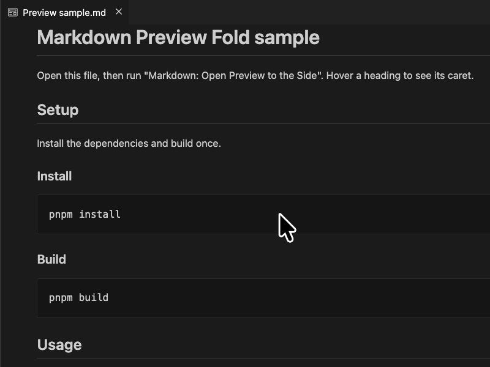

# Markdown Preview Fold

Fold heading sections in the built-in Markdown preview of VS Code, Cursor and other VS Code based editors.

## Features

- A caret next to every heading that has something under it. It shows on hover, and stays visible while the section is folded.
- A folded heading shows a "…" after its text.
- Subsections keep their own state: fold "Install", fold and unfold "Setup", and "Install" is still folded.
- The state survives edits, tab switches and restarts, separately for each file.
- Collapse All and Expand All in the preview's title bar, in the Command Palette and on the keyboard.
- A link into a folded section opens the sections above its target.
- Colors come from your theme, including high contrast themes. The caret is a real button, so it works with the keyboard and screen readers.

## Usage

Open a Markdown file and run **Markdown: Open Preview to the Side** (`Cmd+K V` on macOS, `Ctrl+K V` on Windows and Linux).

| Action                          | How                                                               |
| ------------------------------- | ----------------------------------------------------------------- |
| Fold or unfold a section        | Click the caret next to the heading, or focus it and press Enter  |
| Fold or unfold with subsections | Option+click (macOS) or Alt+click the caret                       |
| Collapse all sections           | Title bar icon, or `Cmd+K Cmd+0` / `Ctrl+K Ctrl+0` in the preview |
| Expand all sections             | Title bar icon, or `Cmd+K Cmd+J` / `Ctrl+K Ctrl+J` in the preview |
| Jump into a folded section      | Click a link to a heading inside it                               |

The key bindings only apply while the preview has focus. In the text editor the same keys fold code as usual.

## Where it works

- **VS Code 1.90 and later**: the built-in Markdown preview.
- **Cursor**: the classic preview ("Markdown: Open Preview to the Side"). Cursor's own inline Markdown editor is part of Cursor's workbench and has no extension API, so it can't be extended.
- Previews owned by other extensions, such as Markdown Preview Enhanced, are out of reach.

## How the state is stored

The folded sections of each file are kept in the preview's `localStorage`, keyed by the file's URI. The extension keeps the 200 most recently changed files. The state stays on your machine and isn't synced.

## Known limitations

- A section is identified by its heading path. Renaming a heading opens that section and its subsections.
- Adding a heading with the same text above a sibling with that text swaps their states.
- Only top-level headings fold. A heading inside a list or a quote doesn't get a caret.
- Collapse All and Expand All act on every open preview: the extension can't tell which preview has focus.
- Right after a fold, scroll sync may still map lines to the folded content until the next edit.

## Privacy

No telemetry and no network requests.

## Contributing

Bug reports and ideas are welcome. See [CONTRIBUTING.md](CONTRIBUTING.md). How it works: [docs/architecture.md](docs/architecture.md). Why it works this way: [docs/decisions.md](docs/decisions.md).

## License

[MIT](LICENSE)
