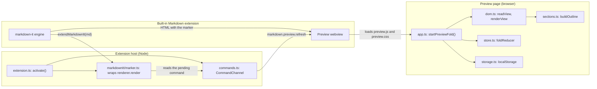
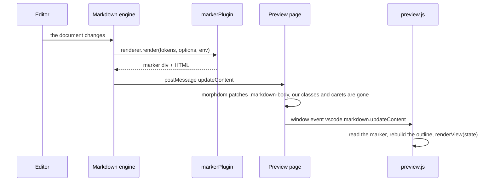

# Architecture

Markdown Preview Fold adds folding to the built-in Markdown preview. It doesn't render Markdown and it doesn't own a webview. It plugs into the preview through three contribution points of the built-in Markdown extension (`markdown-language-features`):

| Contribution                 | Our file                                 | What it does                                                                      |
| ---------------------------- | ---------------------------------------- | --------------------------------------------------------------------------------- |
| `markdown.previewScripts`    | `dist/preview.js`                        | Runs inside the preview page: carets, folding, state                              |
| `markdown.previewStyles`     | `media/preview.css`                      | Styles the carets and hides folded blocks                                         |
| `markdown.markdownItPlugins` | `dist/extension.js` (`extendMarkdownIt`) | Adds a hidden marker with the document URI and the pending command to each render |

The decisions behind this design are in [decisions.md](decisions.md).

## Two runtimes

The code runs in two places that can't call each other.

- **The extension host** is a Node process. It has the `vscode` API: commands, menus, key bindings. It sees the Markdown engine, but not the preview page.
- **The preview page** is a browser page inside a webview. It has the DOM and `localStorage`. It can't import `vscode`, and the built-in preview already holds the only `acquireVsCodeApi()` handle, so it can't message our extension either.

The only channel from the host to the page is the HTML the host renders. That's what the marker is for.



`src/shared/protocol.ts` defines the marker's class and the command format. It's pure, so both bundles import it.

## The update cycle

The preview never reloads the page when the document changes. It renders new HTML in the extension host, posts it to the page, and patches the DOM with morphdom. Morphdom removes everything we added, so the script applies the state again after each update.



On a first load (opening the preview, switching back to its tab, restarting the editor, a bulk command's refresh), the page is built from scratch. Its HTML has no `.markdown-body`: the preview's own script (`media/index.js`) adds it from a data attribute after `DOMContentLoaded`, and fires no `vscode.markdown.updateContent` for it. That script and ours are both loaded with `async`, so either can run first. The script therefore observes the document with a `MutationObserver` and runs `update()` as soon as `.markdown-body` is there, or at once if it already is. The first `update()` stops the observer, and later updates come through the event.

## The outline

`readView` takes the direct children of `.markdown-body`, skips the marker, and turns each one into a block: a heading with its level and text, or content. `buildOutline` turns the blocks into sections:

- A heading opens a section. The section ends at the next heading of the same or a higher level.
- Each section knows its parent, its children, and whether it has a body (content or subsections). A section without a body gets no caret.
- `owners[i]` is the innermost section that contains block `i`. A heading belongs to its parent's section.
- A block is hidden when its owner or any ancestor of its owner is collapsed (`isHiddenBy`). That's why a folded subsection stays folded when its parent opens: its key is still in the state.

**Section keys** must survive edits, so they come from the headings, not from positions:

```text
Guide#0
Guide#0 › Setup#0
Guide#0 › Setup#0 › Install#0
Guide#0 › Notes#0
Guide#0 › Notes#1        a second "Notes" under the same parent
```

A key is the parent's key, the heading text with collapsed whitespace, and the index of that text among the parent's children. Edits to content keep every key. Renaming a heading changes its key and its descendants' keys.

## State and storage

- **State** is a `ReadonlySet<string>` of collapsed keys. It changes only through `foldReducer` and four events: `toggle` (with `recursive` for Alt+click), `collapseAll`, `expandAll`, and `reveal` (for links into folded sections).
- **Storage** is one `localStorage` entry, `markdownPreviewFold`:

  ```json
  {
    "version": 1,
    "docs": { "file:///notes/a.md": { "collapsed": ["Guide#0"], "touched": 1795211457838 } }
  }
  ```

  It keeps the 200 most recently saved documents. A document with nothing collapsed is removed. Unknown or broken data is ignored, and errors from `localStorage` are swallowed, so folding keeps working for the session.

- **Why `localStorage` works here:** the workbench gives each webview type a stable origin, so the preview's storage survives closing the tab and restarting the editor. All previews share it, which is why entries are keyed by document URI.

## Bulk commands

Collapse All and Expand All are VS Code commands, and the host can't reach the page directly. So:

1. The command stores an encoded command, `collapseAll:<uuid>`, in `CommandChannel` for 1.5 seconds.
2. It runs `markdown.preview.refresh`, which renders every open preview again, even when the text didn't change. The refresh is forced, so the preview sets the webview's HTML and the page reloads, instead of a `vscode.markdown.updateContent`.
3. `markerPlugin` adds `data-cmd="collapseAll:<uuid>"` to the marker in that render.
4. The script applies a command id once per page, including on the page's first update, which is where the reload delivers it. A page that loads within the 1.5 seconds for another reason, such as a preview opened right after the command, applies it too.

The marker is added in `renderer.render`, not in a core rule. The engine caches parsed tokens per document version, and it passes `env.currentDocument` only to `render`. A core rule would see neither a new command nor the document.

The commands act on every open preview. The host can't tell which preview is focused.

## Scroll sync

The preview maps source lines to elements with the `code-line` class, and caches that list per document version. A hidden element has an empty box, which would confuse that map. `renderView` removes `code-line` from hidden elements and their children, and marks them with `data-mdfold-line` to restore it when they show again.

## Files

| Path                       | Runtime | Role                                                             |
| -------------------------- | ------- | ---------------------------------------------------------------- |
| `src/extension.ts`         | Node    | `activate()`: registers the commands, returns `extendMarkdownIt` |
| `src/commands.ts`          | Node    | `CommandChannel`: holds the pending command, triggers a refresh  |
| `src/markdownIt/marker.ts` | Node    | Wraps `renderer.render` to add the marker                        |
| `src/shared/protocol.ts`   | both    | Marker class, command encoding                                   |
| `src/preview/index.ts`     | page    | Entry: `startPreviewFold(createStorage(browserStore()))`         |
| `src/preview/app.ts`       | page    | Events: updates, clicks, double-clicks; owns the state           |
| `src/preview/dom.ts`       | page    | `readView`, idempotent `renderView`, carets                      |
| `src/preview/sections.ts`  | page    | Pure: outline, keys, visibility                                  |
| `src/preview/store.ts`     | page    | Pure: `foldReducer`                                              |
| `src/preview/storage.ts`   | page    | `localStorage` adapter                                           |
| `media/preview.css`        | page    | Carets, hidden blocks, the "…" badge, focus, reduced motion      |

## Tests

| Layer              | Tool                       | Where                     | What it proves                                                                                                               |
| ------------------ | -------------------------- | ------------------------- | ---------------------------------------------------------------------------------------------------------------------------- |
| Unit, host         | Vitest, Node               | `test/node/`              | Protocol, marker HTML and escaping, the command TTL                                                                          |
| Unit and DOM, page | Vitest, jsdom              | `test/preview/`           | Outline and keys, reducer, storage, `renderView`, and the whole script against a stand-in preview that updates with morphdom |
| Integration        | `@vscode/test-cli`, Mocha  | `test/integration/`       | In a real VS Code: activation, commands, and the marker in `markdown.api.render` output                                      |
| Manual             | Extension Development Host | `test/fixtures/sample.md` | Looks, themes, keyboard, title bar, shortcuts, scroll sync                                                                   |
